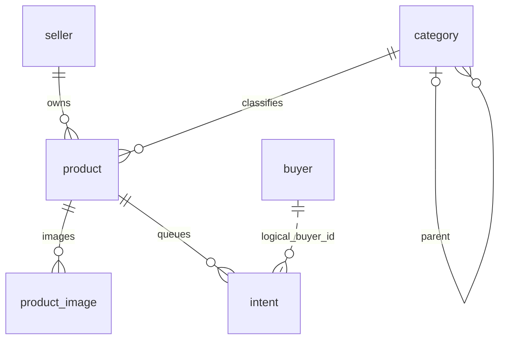
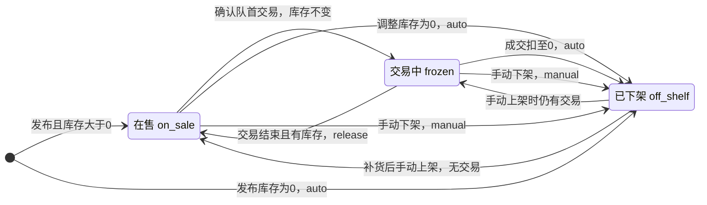

# 第5组 迭代2数据库设计

初稿：胡成溯。2026-10-22按已合入的671ae63同步；数据库为SQLite，默认文件`./data/shop.db`。本页描述当前实现，不把旧稿的计划当作现有表。

## 1 初始化与关系

实际六张表：seller、buyer、category、product、product_image、intent。启动按00-base、01-buyer、02-product、03-intent顺序执行四份SQL，入口由application.yml的schema-locations指定，不存在单文件schema.sql。

category.parent_id、product.seller_id/category_id、product_image.product_id、intent.product_id有数据库外键。intent.buyer_id是逻辑关联，当前DDL没有REFERENCES buyer；不能写成数据库已经强制校验买家外键。两级深度和商品必须挂启用二级类由服务层校验。

## 2 字段与约束

以下字段、类型、默认值和外键根据当前四份SQL在内存库解析生成；不读取真实业务库。

### buyer

| 字段 | 类型 | 列约束 |
| --- | --- | --- |
| `id` | INTEGER | 主键 |
| `username` | TEXT | NOT NULL |
| `password_hash` | TEXT | NOT NULL |
| `salt` | TEXT | NOT NULL |
| `phone` | TEXT | NOT NULL |
| `default_place` | TEXT | 可空 |
| `created_at` | INTEGER | NOT NULL |

### category

| 字段 | 类型 | 列约束 |
| --- | --- | --- |
| `id` | INTEGER | 主键 |
| `parent_id` | INTEGER | FK → category(id) |
| `name` | TEXT | NOT NULL |
| `sort_no` | INTEGER | NOT NULL；DEFAULT 0 |
| `status` | TEXT | NOT NULL；DEFAULT 'enabled' |
| `created_at` | INTEGER | NOT NULL |
| `updated_at` | INTEGER | NOT NULL |

### intent

| 字段 | 类型 | 列约束 |
| --- | --- | --- |
| `id` | INTEGER | 主键 |
| `product_id` | INTEGER | NOT NULL；FK → product(id) |
| `buyer_id` | INTEGER | NOT NULL；DEFAULT 0 |
| `buyer_name` | TEXT | NOT NULL；DEFAULT '' |
| `phone` | TEXT | NOT NULL；DEFAULT '' |
| `trade_address` | TEXT | NOT NULL；DEFAULT '' |
| `token_code` | TEXT | 可空 |
| `status` | TEXT | NOT NULL；DEFAULT 'pending' |
| `trade_result` | TEXT | 可空 |
| `fail_reason` | TEXT | 可空 |
| `created_at` | INTEGER | NOT NULL |
| `finished_at` | INTEGER | 可空 |

### product

| 字段 | 类型 | 列约束 |
| --- | --- | --- |
| `id` | INTEGER | 主键 |
| `seller_id` | INTEGER | NOT NULL；FK → seller(id) |
| `category_id` | INTEGER | NOT NULL；FK → category(id) |
| `name` | TEXT | NOT NULL |
| `description` | TEXT | NOT NULL；DEFAULT '' |
| `image_path` | TEXT | NOT NULL；DEFAULT 'images/placeholder.png' |
| `price_cents` | INTEGER | NOT NULL |
| `stock` | INTEGER | NOT NULL；DEFAULT 1 |
| `off_reason` | TEXT | 可空 |
| `status` | TEXT | NOT NULL；DEFAULT 'on_sale' |
| `published_at` | INTEGER | NOT NULL |
| `updated_at` | INTEGER | NOT NULL |
| `traded_at` | INTEGER | 可空 |
| `trade_result` | TEXT | 可空 |

### product_image

| 字段 | 类型 | 列约束 |
| --- | --- | --- |
| `id` | INTEGER | 主键 |
| `product_id` | INTEGER | NOT NULL；FK → product(id) |
| `file_path` | TEXT | NOT NULL |
| `sort_no` | INTEGER | NOT NULL |
| `is_primary` | INTEGER | NOT NULL；DEFAULT 0 |

### seller

| 字段 | 类型 | 列约束 |
| --- | --- | --- |
| `id` | INTEGER | 主键 |
| `username` | TEXT | NOT NULL |
| `password_hash` | TEXT | NOT NULL |
| `salt` | TEXT | NOT NULL |
| `created_at` | INTEGER | NOT NULL |

### 业务规则与CHECK/唯一性

- category：UNIQUE(parent_id,name)；一级parent_id为NULL；ProductSchemaMigrator额外建立根分类名称的部分唯一索引uq_category_root_name。同父级不重名，但不同父级可同名。启用/停用；有子类或商品引用不能删除。
- product：category_id必填；名称trim后非空；price_cents>0；stock>=0。status允许on_sale/frozen/off_shelf/delisted，off_reason允许auto/manual或NULL。当前业务不编辑名称、价格、描述或图片，不删除商品；updated_at用于发布、库存及状态变化。
- product_image：同商品sort_no唯一，is_primary为0/1；部分唯一索引保证最多一个主图。每商品最多9张由发布服务校验；图片路径存file_path，product.image_path同步主图。
- buyer/seller：用户名各自唯一，加盐密码；buyer.phone必填不唯一，default_place选填。
- intent：新单buyer_id为真实登录买家，姓名/电话/地点保存快照；无quantity，一次意向1件。buyer_id默认0仅兼容遗留记录。token_code可空，新单不生成。success/failed记录trade_result、finished_at及失败原因；cancelled仅保留旧码兼容。

## 3 显式索引

| 索引 | 表 | 实际定义 |
| --- | --- | --- |
| idx_buyer_created | buyer | `CREATE INDEX idx_buyer_created ON buyer (created_at)` |
| idx_buyer_phone | buyer | `CREATE INDEX idx_buyer_phone ON buyer (phone)` |
| idx_intent_buyer | intent | `CREATE INDEX idx_intent_buyer ON intent (buyer_id, status, finished_at)` |
| idx_intent_buyer_id | intent | `CREATE INDEX idx_intent_buyer_id ON intent (buyer_id, created_at)` |
| idx_intent_phone | intent | `CREATE INDEX idx_intent_phone ON intent (phone)` |
| idx_intent_queue | intent | `CREATE INDEX idx_intent_queue ON intent (product_id, status, created_at)` |
| idx_product_category | product | `CREATE INDEX idx_product_category ON product(category_id,status)` |
| idx_product_image_primary | product_image | `CREATE UNIQUE INDEX idx_product_image_primary ON product_image(product_id) WHERE is_primary=1` |
| idx_product_seller | product | `CREATE INDEX idx_product_seller ON product(seller_id,status)` |
| idx_product_status | product | `CREATE INDEX idx_product_status ON product(status,published_at)` |
| uq_category_root_name | category | `CREATE UNIQUE INDEX uq_category_root_name ON category(name) WHERE parent_id IS NULL` |
| uq_intent_buyer_active | intent | `CREATE UNIQUE INDEX uq_intent_buyer_active ON intent (buyer_id, product_id)     WHERE status IN ('pending', 'trading') AND buyer_id > 0` |
| uq_intent_token | intent | `CREATE UNIQUE INDEX uq_intent_token ON intent (token_code)     WHERE token_code IS NOT NULL` |

## 4 商品与队列状态

| 动作 | 库存变化 | 状态和队列 |
| --- | --- | --- |
| 发布商品 | 指定非负整数 | 大于0为on_sale；0为off_shelf/auto |
| 提交意向 | 不扣 | 要求登录、在售且有库存；进入pending |
| 确认队首交易 | 不扣 | 意向trading，商品frozen |
| 标记成功 | 原子扣1 | 意向success；库存归零则off_shelf/auto并将pending置failed，否则release恢复在售 |
| 标记失败 | 不扣 | 意向failed或重回pending队尾；商品通过release恢复，手动下架保持下架 |
| 手动下架 | 不扣 | on_sale或frozen均可变为off_shelf/manual |
| 调整库存 | 改为输入值 | 为0时off_shelf/auto并结束pending；有交易时禁止直接调为0 |
| 补货后重新上架 | 不扣 | 要求库存>0；无交易恢复on_sale，有交易恢复frozen |

`release()`只处理frozen，不能覆盖已下架状态。`delisted`仅兼容历史商品，不是当前发布/下架入口写入的主状态。商品级`traded_at/trade_result`为兼容字段，本次交易结果与时间记录在intent。

意向按created_at,id升序排队。pending→trading→success/failed；失败重排时回pending并刷新created_at，后续确认由卖家触发，不自动让下一位进入trading。只有库存归零才批量结束其余pending，不能写成任意一笔成交都清空队列。我的订单按finished_at倒序，仅含success/failed。

## 5 事务与数据升级

Hikari连接池为1，每个连接启用外键；00-base启用WAL。StockService的条件UPDATE保证单次扣减stock>0，同一事务通知队列。既有5任务并发测试验证库存3时3成功/2拒绝，不能据此推断压力或生产保证。

ProductSchemaMigrator（Order10）处理旧Java商品/分类表，先VACUUM INTO备份，再事务重建并保留编号、商品与关联，失败回滚；旧商品默认库存1、原一级/未分类商品进入迁移二级类。根分类唯一索引由该迁移器补建。

IntentSchemaMigrator（Order20）属于交易模块：旧表缺buyer_id时直接重建intent，不保留旧匿名意向；现有buyer_id时跳过。本次商品迁移测试不能替代订单迁移核对。Python基线库没有经过本轮迁移验证，不直接接入当前Java数据源。演示使用独立库，文档不要求删除原库。

商品traded_at/trade_result是兼容字段，当前订单结果以intent.finished_at/trade_result为准。补货与上下架不应按旧稿清空或改写历史交易结果。

## 6 来源与验证

- [00-base.sql](../src/main/resources/schema/00-base.sql)
- [01-buyer.sql](../src/main/resources/schema/01-buyer.sql)
- [02-product.sql](../src/main/resources/schema/02-product.sql)
- [03-intent.sql](../src/main/resources/schema/03-intent.sql)
- [商品契约](契约-商品中心-迭代2.md)、[测试记录](商品中心测试记录-20261021.md)。83项测试是2026-10-21 23:19的已有记录，本次只验证文档、DDL结构和链接，没有重跑业务测试。
