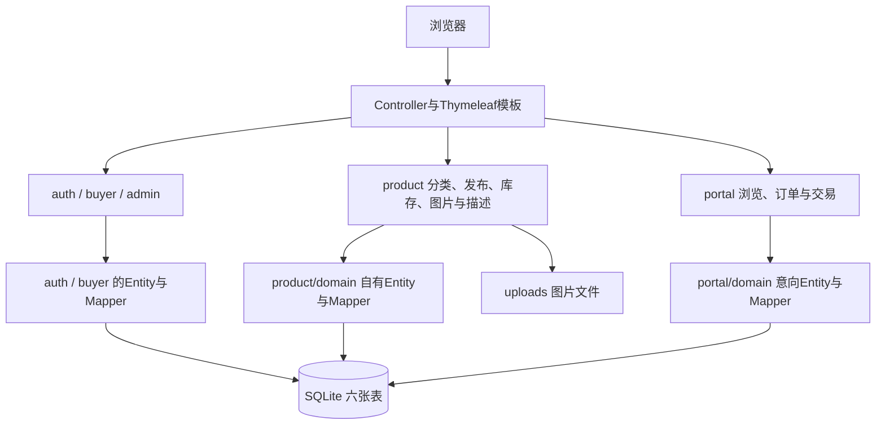
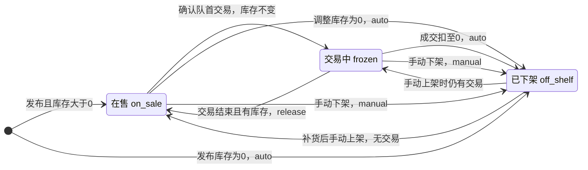
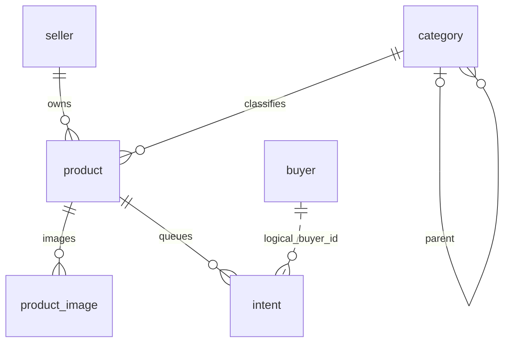

# 在线购物系统 架构设计与数据库表结构（迭代2）

初稿：胡成溯。2026-10-22按iter2-java合并提交671ae63同步。商品中心T2-08～T2-12已合入，当前设计以Controller、Service、四份schema及[商品中心契约](契约-商品中心-迭代2.md)为依据。Python基线保留在main，不覆盖基线成果或原始澄清记录。

## 1 技术与模块

Java17编译目标；Spring Boot3.3.5、MyBatis-Plus3.5.7、Thymeleaf、SQLite JDBC3.46.1.3，服务端渲染单体。新增Jsoup1.20.1过滤商品富文本。数据库、上传文件分别默认位于data/和uploads/。

| 负责人 | 模块与任务 | 当前职责 |
| --- | --- | --- |
| 胡成溯 | auth、buyer、admin，T2-01～T2-07 | 基座、卖家登录、客户账号与客户管理 |
| 黄程宇 | product，T2-08～T2-12 | 分类、发布、库存、上下架、图集、富文本 |
| 周到 | portal，T2-13～T2-18 | 浏览搜索、下单、订单、队列与交易确认 |

common保留公共返回体、配置、异常和工具等，Entity/Mapper位于各模块domain。商品新实现不写intent表；队列适配在portal内调用其Mapper。现有门户查询仍直接使用商品Entity/Mapper，是当前实现边界，不能宣称全部跨模块访问已解耦。

## 2 模块间调用

- BuyerContext.current()提供买家身份；卖家上下文适配读取已登录Session。
- CategoryQueryService实现CategoryPort，返回启用的两级分类树。
- ProductDetailService实现ProductPort，提供图片、库存及freeze/release/deduct；ProductQueryService提供在售商品查询。
- 库存归零时StockService调用IntentQueuePort；portal中的ProductQueueAdapter转调IntentMapper结束pending队列，并提供hasTrading。
- IntentHistoryProvider实现admin侧IntentHistoryPort，供客户购买历史展示。商品临时探针SchemaCapability/PortalProbeMapper及无限库存降级已移除。

## 3 商品状态与成交

| 动作 | 库存变化 | 状态和队列 |
| --- | --- | --- |
| 发布商品 | 指定非负整数 | 大于0为on_sale；0为off_shelf/auto |
| 提交意向 | 不扣 | 要求登录、在售且有库存；进入pending |
| 确认队首交易 | 不扣 | 意向trading，商品frozen |
| 标记成功 | 原子扣1 | 意向success；库存归零则off_shelf/auto并将pending置failed，否则release恢复在售 |
| 标记失败 | 不扣 | 意向failed或重回pending队尾；商品通过release恢复，手动下架保持下架 |
| 手动下架 | 不扣 | on_sale或frozen均可变为off_shelf/manual |
| 调整库存 | 改为输入值 | 为0时off_shelf/auto并结束pending；有交易时禁止直接调为0 |
| 补货后重新上架 | 不扣 | 要求库存>0；无交易恢复on_sale，有交易恢复frozen |

`release()`只处理frozen，不能覆盖已下架状态。`delisted`仅兼容历史商品，不是当前发布/下架入口写入的主状态。商品级`traded_at/trade_result`为兼容字段，本次交易结果与时间记录在intent。

只改库存和上下架，不编辑或删除已发布商品。商品整件冻结，同一时刻一笔交易；未结束交易时不允许把库存直接改为0，这是实现约束，团队联调时确认。

## 4 意向与身份

浏览公开，提交意向必须登录。新单不生成token_code，客户页面没有撤销入口，旧码撤销接口仅作兼容。买家签名BUYER_SESSION与卖家HttpSession的SHOP_SESSION独立；不要将设计中的SELLER_SESSION写成实际cookie名。

意向按created_at,id先到先得；卖家仅确认队首。失败可置failed或回pending队尾；下一位仍由卖家确认。成功扣1，只有库存归零才结束剩余pending。客户历史只显示success/failed，按finished_at倒序分页；商品级历史字段不替代订单字段。

## 5 数据结构

实际六表及字段、外键、CHECK、唯一性、索引以[数据库设计](数据库设计-迭代2.md)为准；初始化是schema/00-base.sql→01-buyer.sql→02-product.sql→03-intent.sql。intent.buyer_id为逻辑关联，不是当前DDL中的外键。

## 6 页面接口与上传

| 方法 | 路径 | 入参 | 响应/模型 |
| --- | --- | --- | --- |
| GET | /admin/products | status选填 | product/list；products、selectedStatus |
| GET | /admin/products/new | 无 | product/publish；tree |
| GET | /admin/products/publish | 无 | 同发布页 |
| POST | /admin/products | name、price、categoryId、stock、description、images、imageOrder、primaryIndex | 成功回/admin/products；业务失败回/admin/products/new |
| POST | /admin/products/{id}/stock | stock | 调整库存后回/admin/products |
| POST | /admin/products/{id}/off-shelf | 无 | 手动下架后回/admin/products |
| POST | /admin/products/{id}/relist | 无 | 重新上架后回/admin/products |
| GET | /admin/categories | 无 | product/categories；categories |
| POST | /admin/categories | name、parentId选填、sortNo默认0 | 新增分类后回/admin/categories |
| POST | /admin/categories/{id}/status | enabled布尔值 | 启停后回/admin/categories |
| POST | /admin/categories/{id}/delete | 无 | 仅删除无子类、无商品引用的分类 |

后台继承卖家鉴权；商品操作校验所有权。GET成功200，表单redirect当前默认302，商品模块使用Flash提示。完整门户/账号路由见[总API契约](API契约-迭代2.md)与[账号契约](契约-账号与客户-迭代2.md)。

每商品发布时最多9张图片，5MiB/张，JPG/JPEG/PNG，检查后缀、文件头与解码；封面与顺序发布后不可改。富文本先白名单过滤再渲染，允许图片和受信播放器iframe，不能继续写原样保存或只靠Thymeleaf默认转义。

## 7 初始化、迁移与验证

新库由四份SQL初始化。旧Java商品库先一致性备份后事务升级；商品编号和关联保留，失败回滚。订单迁移器对旧匿名意向的重建需另行核对，不能把商品迁移当作整库无损升级。具体见数据库设计。

已记录2026-10-21 23:19全量83项通过（新增16项），环境Windows/JDK25/Maven3.9.11、编译目标Java17。本机Byte Buddy需实验兼容开关；团队Java17运行、外站视频真实播放、录屏与教师验收仍待对应证据。本次文档维护没有更改业务代码、重跑测试或生成交付包。

## 8 版本说明

本次同步替换早期正文中的四表、可编辑商品、库存未实现、冻结留待迭代3、匿名新单与成交即清队列等过期描述。原署名和历史版本保留在Git历史及week06同步前副本；这次维护不改写PM原始澄清问答，任务表与其文本差异继续由团队确认。
